<p align="center"></p>

<h1 align="center">Kikumap</h1>

<p align="center"><b>English</b> · <a href="README.zh-CN.md">简体中文</a></p>

<p align="center">
  <b>A mind map for your Claude chats.</b><br>
  See which chats are running and which are waiting for you, right from the menu bar.<br>
  Sort them into a map. Take them with you.
</p>

<p align="center">
  <a href="https://github.com/tang1693/KIKUmap/releases/latest"></a>
  
  
  <a href="LICENSE"></a>
  <a href="https://github.com/tang1693/KIKUmap/stargazers"></a>
  <a href="https://ko-fi.com/vegligi"></a>
</p>

<h3 align="center"><a href="https://github.com/tang1693/KIKUmap/releases/latest/download/Kikumap.dmg">⬇︎ Download for macOS</a></h3>

<p align="center"><a href="https://ko-fi.com/vegligi"></a></p>

<p align="center">
  <a href="https://tang1693.github.io/KIKUmap/">Website</a> ·
  <a href="#features">Features</a> ·
  <a href="#install">Install</a> ·
  <a href="#privacy">Privacy</a> ·
  <a href="#faq">FAQ</a> ·
  <a href="#support">Support ❤️</a>
</p>

<p align="center">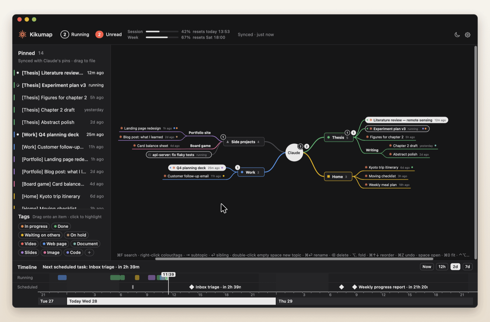</p>

You pinned a dozen chats in Claude. One is drafting your thesis chapter, one is fixing a test, one finished ten minutes ago and you haven't looked. **Kikumap** sits in your menu bar and keeps track: what's running, what's done, what needs your OK. Open it and your pinned chats are laid out as a mind map that you arrange, MindNode-style.

**Native and featherlight.** Swift and AppKit only: no Electron, no web view, no helper processes, no third-party code. A 2.5 MB download that waits for changes instead of polling, and stops drawing entirely when its window is hidden.

https://github.com/user-attachments/assets/5bdd2a3f-29c6-4097-bbca-b5061c95526d

> [!NOTE]
> **Beta.** The Claude app has no public API, so Kikumap reads its window through macOS Accessibility. When Claude changes its interface, parts of Kikumap may stop working until it's updated. Kikumap is an independent project, not made by or affiliated with Anthropic.

## Features

<table>
<tr>
<td width="55%">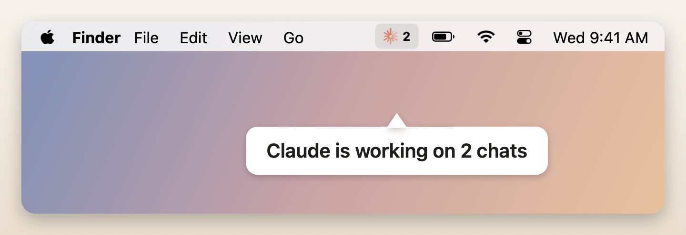</td>
<td>

### Know what Claude is doing

One icon in the menu bar. The orange flower spins while a chat is running. A red badge counts chats that finished and you haven't read, with **!** when one needs your approval.

**Hear it instead of checking.** A sound plays when a chat finishes or needs you, and Kikumap can then say which one ("Experiment plan is done") in the voice, speed and words you choose. Or use your own sound file.

Works with the Claude desktop app and Claude Code (Terminal, VS Code, the app's Code mode). **New in 0.9.5:** the ChatGPT desktop app too. Threads you pin in ChatGPT show next to Claude's, marked **GPT**, with running and unread as ChatGPT shows them.

</td>
</tr>
<tr>
<td>

### Your chats, as a map

The left column mirrors the chats you pinned in Claude, **in Claude's order**, and your Claude Code sessions. The map starts empty: nothing goes on it until you put it there. Drag them onto your own topics. While you drag, the item rides a live branch and the rest of the map slides aside to show where it will land. The map never rearranges itself on its own.

**Several at once:** drag a box on empty space (or ⌘/⇧-click), or ⌘/⇧-click in the left column, then drag any one of them. They all come along, in order. Hold space and move the mouse, or swipe with two fingers, to move around the map. The left column and the timeline can be hidden (⌃⌘S, ⌃⌘T) or resized by dragging their edge, and ⌘+ / ⌘- make everything in the window bigger or smaller.

Real conversations carry a small orange mark, so they stand apart from plain topics. Hover one for two buttons: open it in Claude, or mark it unread again (⇧⌘U) so it waits for you until you've opened it.

</td>
<td width="55%">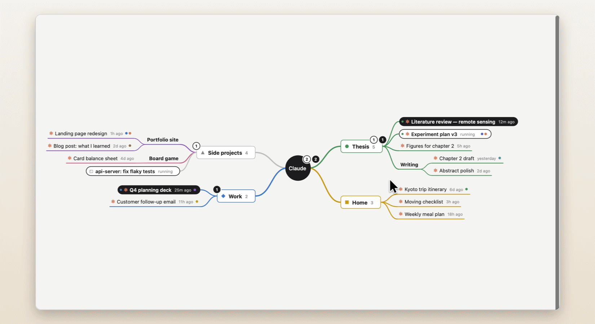</td>
</tr>
<tr>
<td width="55%">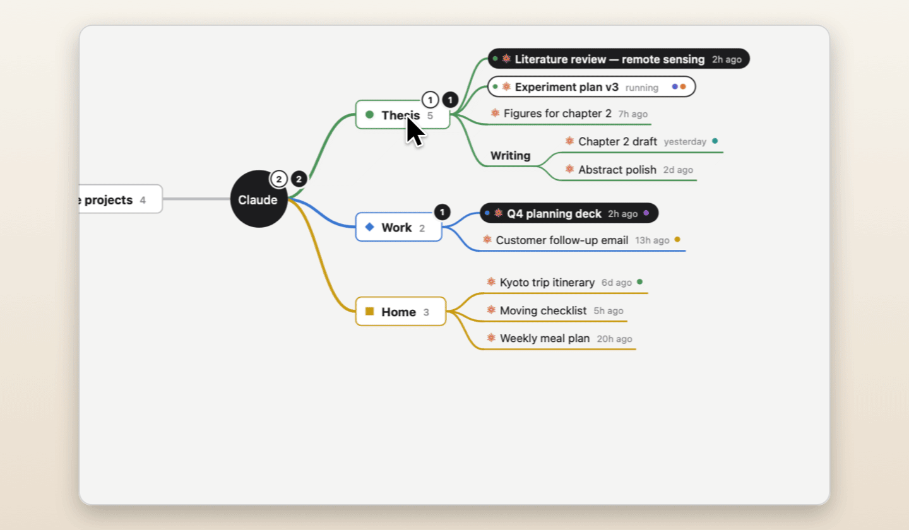</td>
<td>

### Make it yours

Right-click any topic for a branch colour and a shape: square, circle, triangle, diamond, cross or star. Colours flow down the branch, into the timeline and the menu.

</td>
</tr>
<tr>
<td>

### Tag anything

Tags like *In progress*, *Waiting on others* or *Slides*. Pick them from the right-click menu, or drag one from the shelf straight onto a chat.

Click a tag to highlight everything that has it; the rest of the map fades back. Click again to clear.

</td>
<td width="55%">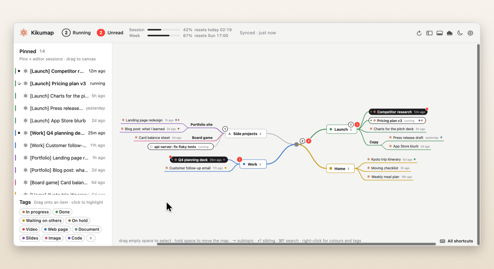</td>
</tr>
<tr>
<td width="55%">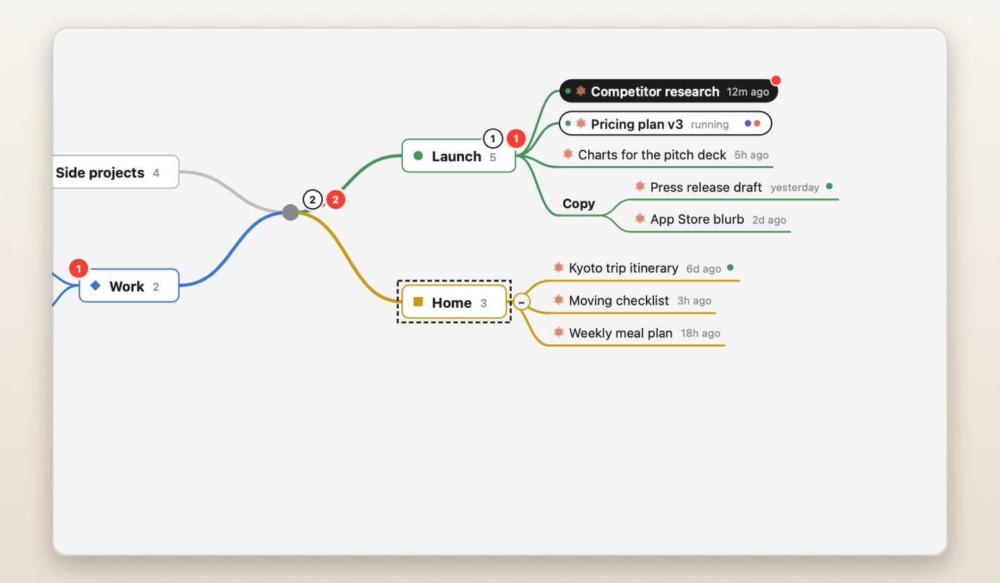</td>
<td>

### Keyboard-first

Like a real mind-map app: ⇥ new subtopic, ⏎ sibling, ⌘↑↓ reorder, ⌘Z undo. Also ⌫ delete, ⌥. fold, ⌘F search, and a tap on space to open a chat in Claude.

</td>
</tr>
<tr>
<td>

### What ran, and what's next

The timeline shows when Claude worked on each chat, in your branch colours; chats running at the same time get rows of their own. Drag ahead to see your scheduled tasks (with usage turned on), each with a live countdown. Click anything to open it.

</td>
<td width="55%">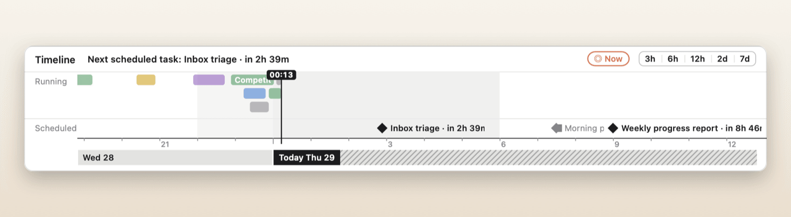</td>
</tr>
<tr>
<td width="55%">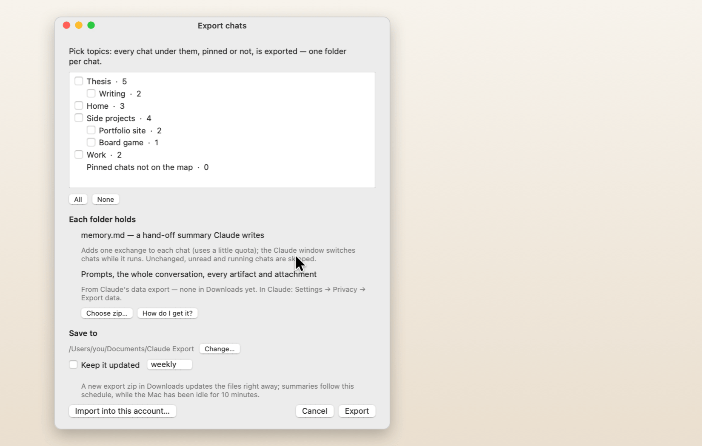</td>
<td>

### Take everything with you

Tick topics and export every chat under them, pinned or not, one folder per chat:

- `memory.md`: a hand-off summary Claude writes inside the chat
- `prompts.md` and `conversation.md`
- `artifacts/` and `attachments/`

The export can keep itself up to date. **Import** starts a new pinned chat per folder (in a new Claude account, say), with the artifacts attached and the summary sent in, so you pick up where you left off.

</td>
</tr>
</table>

### And a lot more

<table>
<tr>
<td width="50%" valign="top">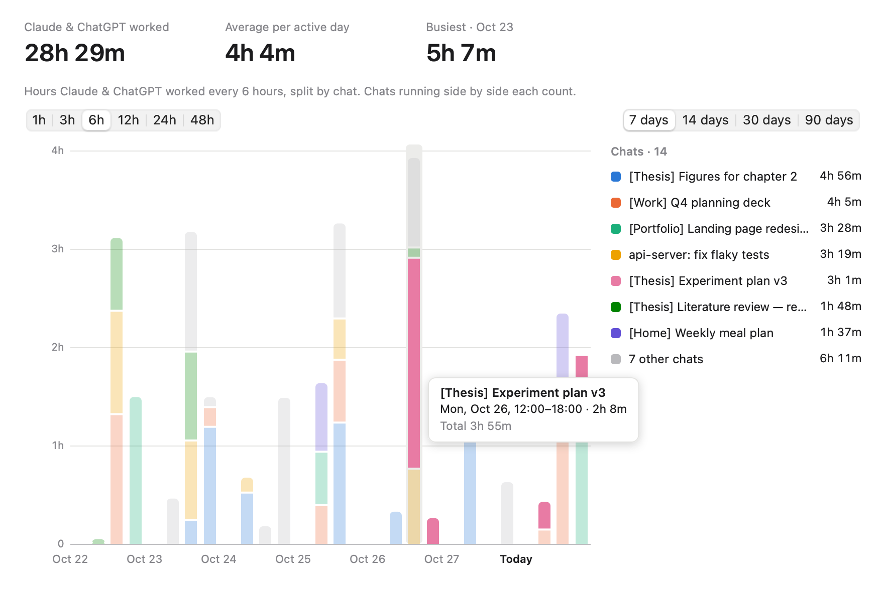<br><b>Statistics</b> <sup>new</sup><br>How long Claude worked each day, one bar per day split by chat, over 7, 14, 30 or 90 days. Hover for details, click a segment to open the chat. View → Statistics (⌘Y) or the menu.</td>
<td width="50%" valign="top">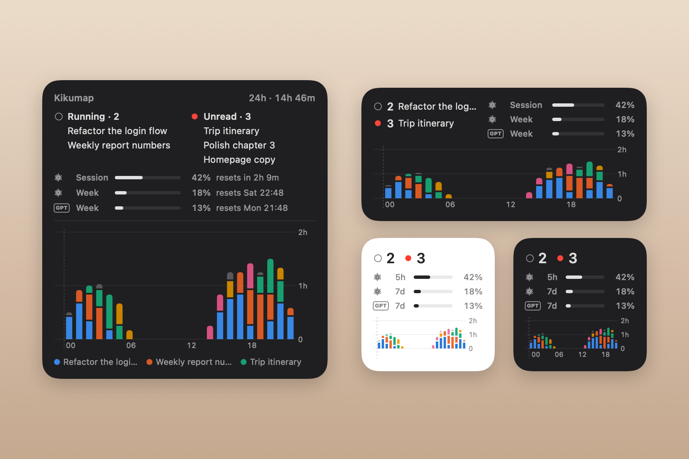<br><b>Desktop widget</b> <sup>new</sup><br>Running and unread chats and your usage on top (Claude's, ChatGPT's, or both), the last 24 hours as bars below. Small, medium and large. macOS 14 or later.</td>
</tr>
<tr>
<td width="50%" valign="top">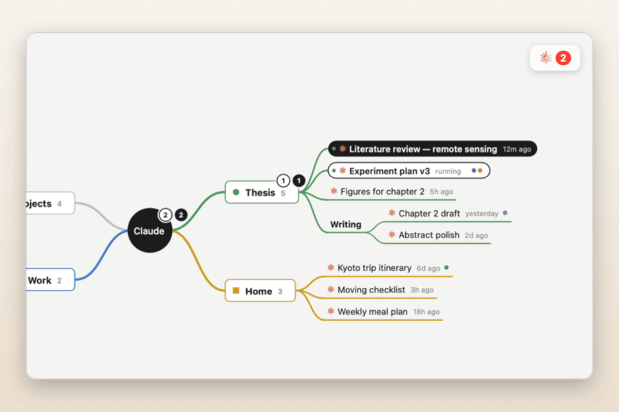<br><b>Finished chats light up</b><br>A chat that's done but unread turns solid on the map, with a red dot.</td>
<td width="50%" valign="top">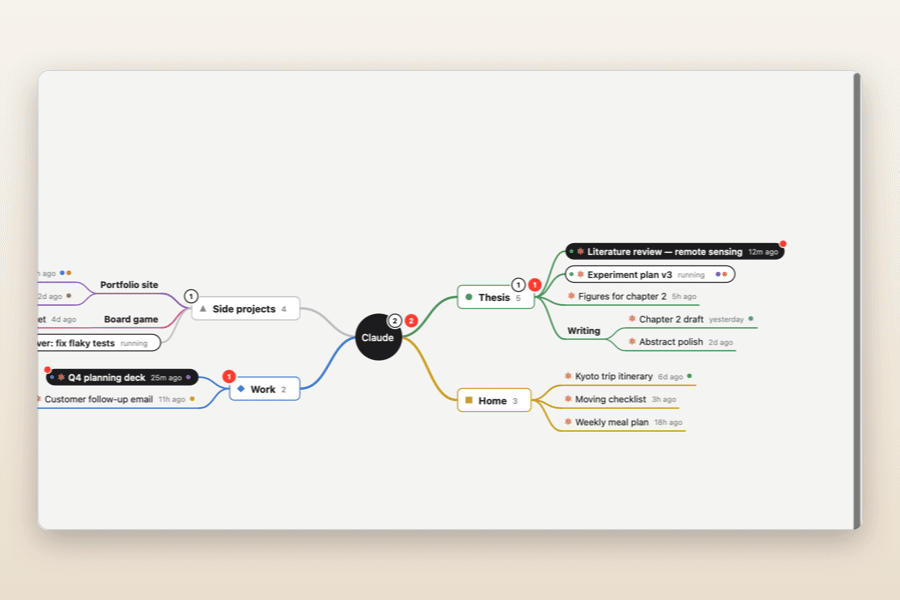<br><b>Find anything</b><br>⌘F searches topics, chats and tags; ⏎ jumps to the next match.</td>
</tr>
<tr>
<td width="50%" valign="top">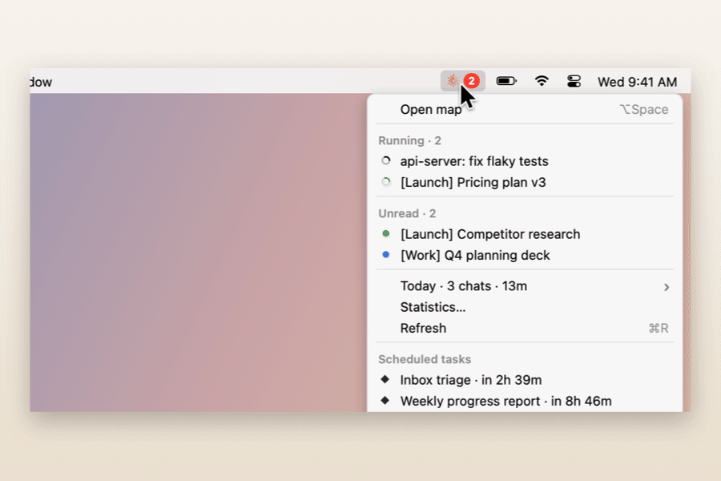<br><b>Your day at a glance</b><br>Which chats Claude worked on today, and for how long, in the menu.</td>
<td width="50%" valign="top">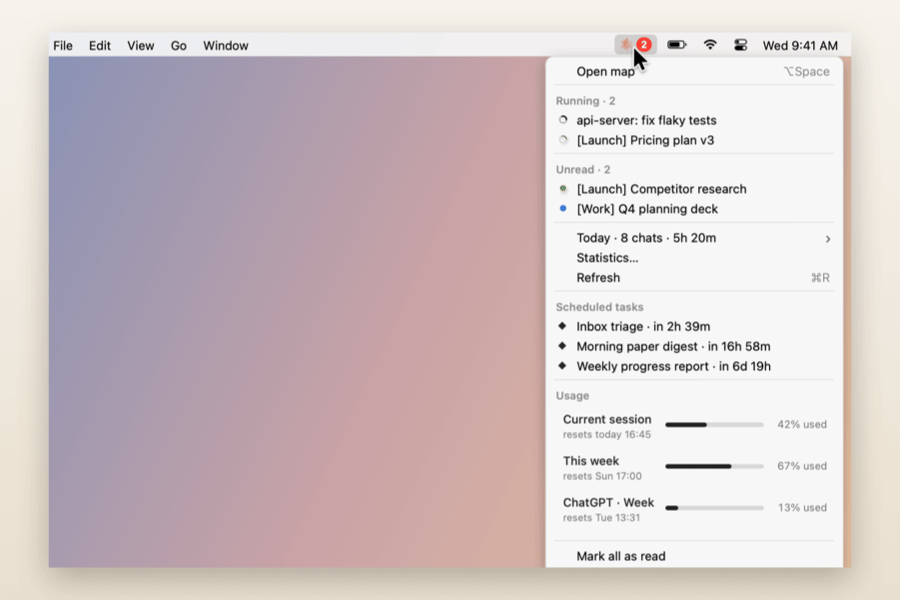<br><b>Usage in the menu</b><br>This session and this week, like claude.ai, plus what's scheduled next.</td>
</tr>
<tr>
<td width="50%" valign="top">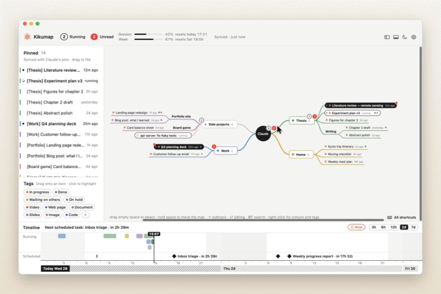<br><b>The map as a PDF</b><br>The whole map on one light page, ready to print or share.</td>
<td width="50%" valign="top">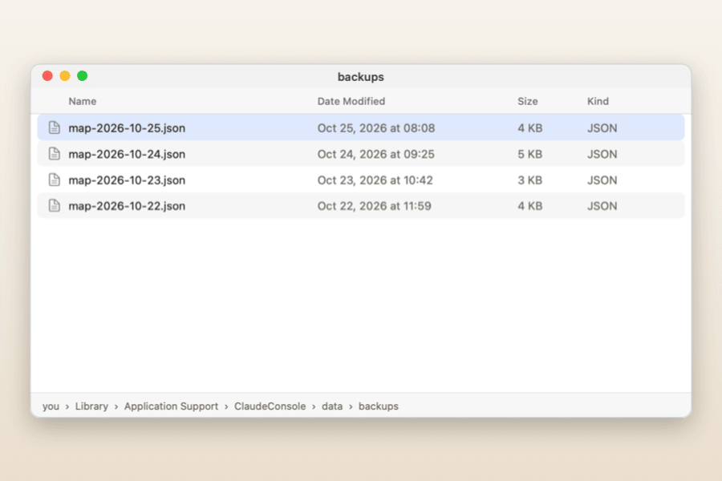<br><b>Daily backups</b><br>A copy of your map every day, before your first change.</td>
</tr>
<tr>
<td width="50%" valign="top">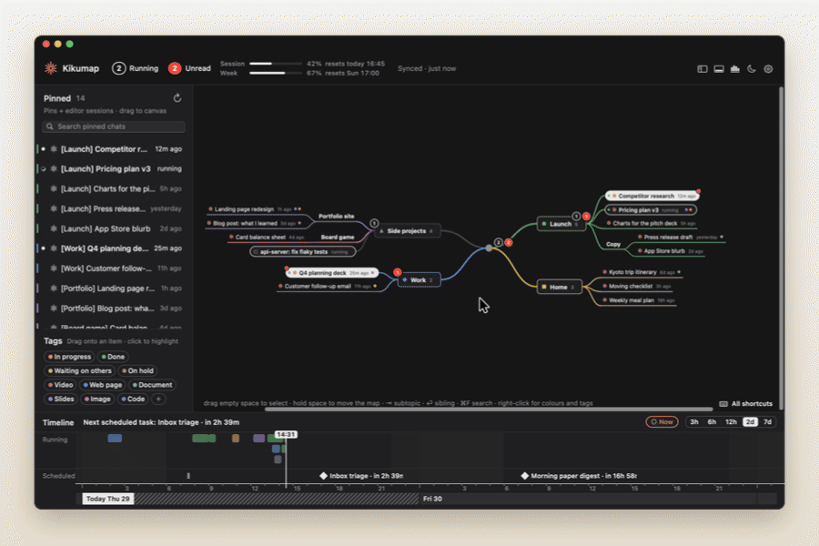<br><b>Light or dark</b><br>Follows your Mac, or flip it with the moon.</td>
<td width="50%" valign="top">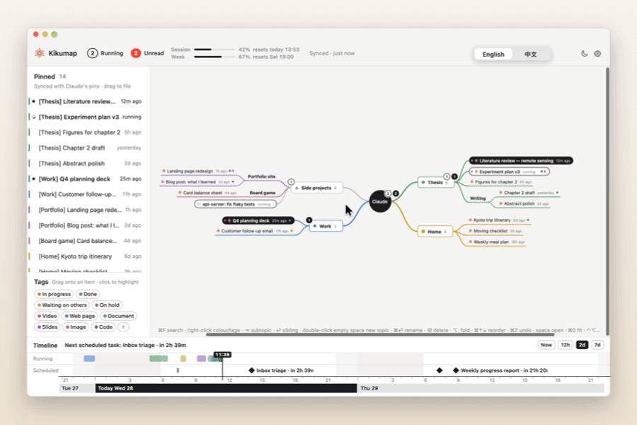<br><b>English · 中文</b><br>Every label, menu and tag in either language.</td>
</tr>
</table>

## Install

**[Download Kikumap.dmg](https://github.com/tang1693/KIKUmap/releases/latest/download/Kikumap.dmg)** (Apple silicon and Intel, macOS 13 or later), open it and drag **Kikumap** to **Applications**.

The first time you open it, macOS says it can't check the app, because it isn't signed with a paid Apple Developer ID:

1. Open **System Settings → Privacy & Security**.
2. Scroll down and click **Open Anyway** next to Kikumap. (On macOS 13–14 you can also right-click the app → Open.)
3. A short intro walks you through the permissions.

In the Claude app, turn on **Response completions** (Settings → Notifications) and keep the sidebar open.

<details>
<summary><b>Build from source</b></summary>

Needs the Xcode Command Line Tools (macOS offers to install them).

```bash
git clone https://github.com/tang1693/KIKUmap.git
cd KIKUmap
open Install.command        # or double-click it in Finder
```

`Install.command` builds with `swiftc`, installs to `~/Applications` and asks whether to start at login. It signs the app with a certificate it creates once in your login keychain, so the permissions you grant survive later rebuilds. `scripts/build-release.sh` builds the universal disk image.
</details>

## Privacy

Everything stays on your Mac, in `~/Library/Application Support/ClaudeConsole/`. The only network requests are usage checks to `api.anthropic.com`, and only if you turn usage on.

No surprise prompts: every macOS permission dialog comes after Kikumap has told you what it's for and you've clicked to go ahead.

| What it shows | Where it comes from | Permission |
|---|---|---|
| Finished / needs your input | The Claude app's notifications in Notification Center (read-only) | Full Disk Access |
| Running, unread, pinned chats | The Claude app's sidebar, through Accessibility | Accessibility |
| Claude Code sessions | Claude Code hooks, added to `~/.claude/settings.json` when you click *Connect* (the old file is backed up) | none |
| ChatGPT threads | What the ChatGPT desktop app keeps in `~/.codex`: its thread list, which ones are unread, and the plan usage of its last answer (read-only; nothing is changed). Turn it off in Settings → Access | none |
| Desktop widget | One file Kikumap writes for it (`widget.json`); the widget is sandboxed and can read only that file | none |
| Usage, scheduled tasks (optional, off by default) | Anthropic's usage API, with the sign-in Claude Code already keeps in your Keychain: read-only, never saved | Keychain, asked only after you turn it on |

**Exporting:** summaries are written by Claude inside each chat, so each adds one exchange and the Claude window switches chats while it runs. Prompts, conversations and artifacts come from Claude's own data export (Claude → Settings → Privacy → Export data); pick the zip in the export window (with Full Disk Access, a zip left in Downloads is found by itself). Import works the Claude window the same way; images and other binary files can't be carried over.

## Keys in the map

| | |
|---|---|
| ⇥ / ⌥⇥ | new child / new parent topic |
| ⏎ / ⌥⏎ / ⇧⏎ | new sibling below / above / new main topic |
| ⌘⏎, double-click | rename (chat names are local) |
| ⌫ | delete; chats go back to the left column |
| ⌥. | fold / unfold |
| ⌘↑ ⌘↓ | move among siblings |
| drag on empty space, ⇧/⌘-click | select several; drag any one to move them all |
| hold space, two-finger swipe | move around the map (a quick tap on space opens the chat) |
| ⌃⌘S / ⌃⌘T | show or hide the left column / the timeline |
| ⌘Y | statistics |
| ⌘A, ⌫ | select everything; delete what's selected |
| ⌘Z / ⇧⌘Z | undo / redo |
| ⌘F | search |
| ⌘E / ⇧⌘E | export the map as PDF / export chats |
| hover a chat → ↗, tap space | open it in Claude |
| ⇧⌘U, hover a chat → ✉ | mark a chat unread / read |
| ⌘+ / ⌘- | everything in the window bigger / smaller (80–160 %) |
| pinch, ⌘0 | zoom the map, fit it to the window |
| ⌃⌥C (changeable) | show / hide the map from anywhere |

## FAQ

<details>
<summary><b>What if I close Claude's window with ⌘W?</b></summary>

That only hides it: Claude keeps running and still sends its "finished" notifications, so Kikumap still marks chats as done and plays its sound. The live "running" spinner and pin syncing read Claude's sidebar, so they pause until the window is back (click Claude in the Dock). Claude Code sessions aren't affected at all.

</details>

<details>
<summary><b>Is this made by Anthropic?</b></summary>

No. Kikumap is an independent, open-source project. Claude is a trademark of Anthropic.
</details>

<details>
<summary><b>Why does it need Accessibility and Full Disk Access?</b></summary>

The Claude app has no API for "which chats are running". Kikumap reads the sidebar (Accessibility) and Claude's notifications (Notification Center's database, which needs Full Disk Access). Both are read-only. Nothing leaves your Mac.
</details>

<details>
<summary><b>Why "Open Anyway"?</b></summary>

Apple charges $99 a year to sign and notarize apps. Kikumap is free, so it isn't notarized. If you'd rather not trust a downloaded build, build it from source: it's plain Swift with no dependencies.
</details>

<details>
<summary><b>Something isn't showing</b></summary>

- **Hover the status in the top bar**: it says what's holding things up (Claude's sidebar hidden, its Pinned section folded, Code mode, the window closed…), what still works, and what to do.
- **Nothing shows as running:** open the Claude app's sidebar. Settings → Access → *Write diagnostic log*, then look at `logs/claude-sidebar.txt` in the data folder.
- **Access shows as off but it's on in System Settings:** remove Kikumap from the list there (−) and add it again. Releases from 0.9.1 on are signed with the same certificate, so updates keep your permissions.
- **Claude Code sessions don't show:** Settings → Access → Claude Code → *Connect*, then start a new session.
- **ChatGPT threads don't show:** Kikumap reads the current ChatGPT desktop app (the one built on Codex). Check Settings → Access → ChatGPT. Like Claude's chats, a thread shows once you pin it in ChatGPT.
- **The widget isn't in the widget gallery:** it needs macOS 14 or later and Kikumap 0.9.5 (build 4) or later in Applications. Open Kikumap once, then right-click the desktop → *Edit Widgets* and search for Kikumap. Still missing? Run `pluginkit -m -v -i ninja.tang.claudeconsole.widget` in Terminal and open an issue with what it prints.
- **No usage:** it's off until you turn it on: Settings → Access → Usage → *Connect*. If it still says signed out, run `claude` in Terminal, then `/login`, and pick your Claude account.
</details>

<details>
<summary><b>Why the name?</b></summary>

*Kiku* (菊) is Japanese for chrysanthemum: the little orange flower in your menu bar, which spins while Claude works. Kikumap is the map that grows out of it.
</details>

## Contributing

Issues and pull requests are welcome, especially when a Claude update breaks something: [open an issue](https://github.com/tang1693/KIKUmap/issues) with what you see.

The code is plain Swift and AppKit, no Xcode project and no dependencies.

| File | What |
|---|---|
| `App.swift` | wiring, global shortcut, opening chats |
| `Watchers.swift` | Notification Center and Claude-sidebar readers |
| `ClaudeCode.swift` | Claude Code hooks and session names |
| `ChatGPT.swift` | ChatGPT desktop app threads (read from `~/.codex`) |
| `Stats.swift` | the statistics window |
| `WidgetFeed.swift`, `Widget/` | the desktop widget and the file it reads |
| `Store.swift` | chats, read state, running intervals |
| `MapModel.swift` / `MapView.swift` | the mind map, dragging, tags, colours, shapes |
| `Timeline.swift` | the time strip |
| `StatusBar.swift` | menu-bar icon and drop-down |
| `Archive.swift` / `ClaudeExport.swift` / `ExportWindow.swift` | export and import |
| `Usage.swift` | usage and scheduled tasks |
| `Settings.swift` / `Onboarding.swift` | settings, permissions, first-launch intro |
| `Theme.swift` / `Logo.swift` | colours, language, the mark and app icon |

<a href="https://star-history.com/#tang1693/KIKUmap&Date">
  
</a>

## Support

Kikumap is free, and it always will be. If it saves you a little tab-hunting every day, a coffee keeps it going ❤️

<p><a href="https://ko-fi.com/vegligi"></a></p>

A ⭐ on GitHub or a bug report helps just as much.

## License

[MIT](LICENSE). Claude is a trademark of Anthropic; this project is independent and not endorsed by Anthropic.
