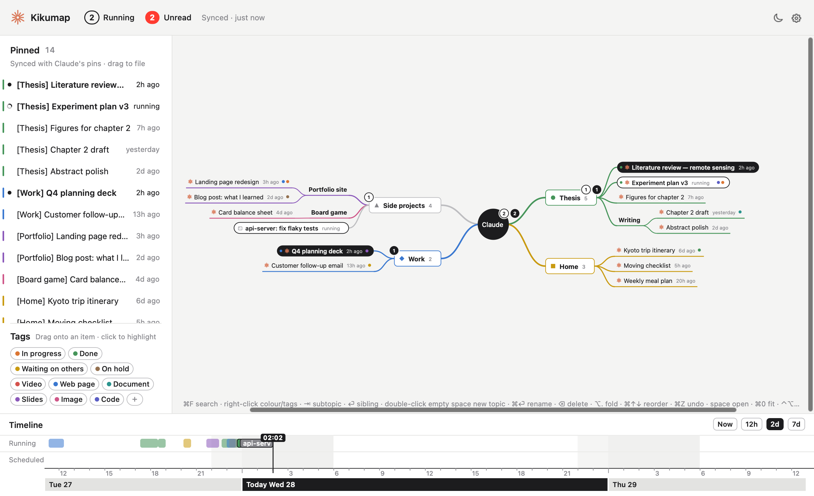

<p align="center"></p>

<h1 align="center">Kikumap</h1>

<p align="center">
  <b>A mind map for your Claude chats.</b><br>
  See which chats are running and which are waiting for you, right from the menu bar.<br>
  Sort them into a map. Take them with you.
</p>

<p align="center">
  <a href="https://github.com/tang1693/kiku/releases/latest"></a>
  
  
  <a href="LICENSE"></a>
  <a href="https://github.com/tang1693/kiku/stargazers"></a>
</p>

<h3 align="center"><a href="https://github.com/tang1693/kiku/releases/latest/download/Kikumap.dmg">⬇︎ Download for macOS</a></h3>

<p align="center">
  <a href="https://tang1693.github.io/KIKU/">Website</a> ·
  <a href="#features">Features</a> ·
  <a href="#install">Install</a> ·
  <a href="#privacy">Privacy</a> ·
  <a href="#faq">FAQ</a> ·
  <a href="#中文说明">中文</a>
</p>

<p align="center"></p>

You pinned a dozen chats in Claude. One is drafting your thesis chapter, one is fixing a test, one finished ten minutes ago and you haven't looked. **Kikumap** sits in your menu bar and keeps track: what's running, what's done, what needs your OK. Open it and your pinned chats are laid out as a mind map that you arrange, MindNode-style.

<p align="center">
  <a href="docs/demo/kikumap-intro.mp4"></a>
</p>

> [!NOTE]
> **Beta.** The Claude app has no public API, so Kikumap reads its window through macOS Accessibility. When Claude changes its interface, parts of Kikumap may stop working until it's updated. Kikumap is an independent project, not made by or affiliated with Anthropic.

## Features

<table>
<tr>
<td width="55%"></td>
<td>

### Know what Claude is doing

One icon in the menu bar. The orange flower spins while a chat is running. A red badge counts chats that finished and you haven't read, with **!** when one needs your approval. Optional sounds tell you without looking.

Works with the Claude desktop app and with Claude Code (Terminal, VS Code, the app's Code mode).

</td>
</tr>
<tr>
<td>

### Your chats, as a map

The left column mirrors the chats you pinned in Claude, **in Claude's order**. Drag them onto your own topics. While you drag, the item rides a live branch and the rest of the map slides aside to show where it will land. The map never rearranges itself on its own.

Real conversations carry a small orange mark, so they stand apart from plain topics. Double-click or press space on one to open it in Claude.

</td>
<td width="55%"></td>
</tr>
<tr>
<td width="55%"></td>
<td>

### Make it yours

Right-click any topic: branch colour, shape (square, circle, triangle, diamond, cross, star), and tags like *In progress*, *Waiting on others* or *Slides*. Click a tag to highlight everything that has it.

Keyboard-first like a real mind-map app: ⇥ new subtopic, ⏎ sibling, ⌘↑↓ reorder, ⌘Z undo.

</td>
</tr>
<tr>
<td>

### Take everything with you

Tick topics and export every chat under them, pinned or not, one folder per chat:

- `memory.md`: a hand-off summary Claude writes inside the chat
- `prompts.md` and `conversation.md`
- `artifacts/` and `attachments/`

The export can keep itself up to date. **Import** starts a new pinned chat per folder (in a new Claude account, say), with the artifacts attached and the summary sent in, so you pick up where you left off.

</td>
<td width="55%"></td>
</tr>
</table>

**And also:** a timeline of when Claude worked on what, with scheduled tasks and countdowns · today's activity in the menu · usage at a glance · ⌘F search · map export to PDF · daily map backups · light and dark · English and 中文.

## Install

**[Download Kikumap.dmg](https://github.com/tang1693/kiku/releases/latest/download/Kikumap.dmg)** (Apple silicon and Intel, macOS 13 or later), open it and drag **Kikumap** to **Applications**.

The first time you open it, macOS says it can't check the app, because it isn't signed with a paid Apple Developer ID:

1. Open **System Settings → Privacy & Security**.
2. Scroll down and click **Open Anyway** next to Kikumap. (On macOS 13–14 you can also right-click the app → Open.)
3. A short intro walks you through the permissions.

In the Claude app, turn on **Response completions** (Settings → Notifications) and keep the sidebar open.

<details>
<summary><b>Build from source</b></summary>

Needs the Xcode Command Line Tools (macOS offers to install them).

```bash
git clone https://github.com/tang1693/kiku.git
cd kiku
open Install.command        # or double-click it in Finder
```

`Install.command` builds with `swiftc`, installs to `~/Applications` and asks whether to start at login. It signs the app with a certificate it creates once in your login keychain, so the permissions you grant survive later rebuilds. `scripts/build-release.sh` builds the universal disk image.
</details>

## Privacy

Everything stays on your Mac, in `~/Library/Application Support/ClaudeConsole/`. The only network requests are usage checks to `api.anthropic.com`.

| What it shows | Where it comes from | Permission |
|---|---|---|
| Finished / needs your input | The Claude app's notifications in Notification Center (read-only) | Full Disk Access |
| Running, unread, pinned chats | The Claude app's sidebar, through Accessibility | Accessibility |
| Claude Code sessions | Claude Code hooks, added to `~/.claude/settings.json` when you click *Connect* (the old file is backed up) | none |
| Usage, scheduled tasks | Anthropic's usage API, with the sign-in Claude Code already keeps in your Keychain | macOS asks once |

**Exporting:** summaries are written by Claude inside each chat, so each adds one exchange and the Claude window switches chats while it runs. Prompts, conversations and artifacts come from Claude's own data export (Claude → Settings → Privacy → Export data); leave the zip in Downloads and Kikumap finds it. Import works the Claude window the same way; images and other binary files can't be carried over.

## Keys in the map

| | |
|---|---|
| ⇥ / ⌥⇥ | new child / new parent topic |
| ⏎ / ⌥⏎ / ⇧⏎ | new sibling below / above / new main topic |
| ⌘⏎, double-click | rename (chat names are local) |
| ⌫ | delete; chats go back to the left column |
| ⌥. | fold / unfold |
| ⌘↑ ⌘↓ | move among siblings |
| ⌘Z / ⇧⌘Z | undo / redo |
| ⌘F | search |
| ⌘E / ⇧⌘E | export the map as PDF / export chats |
| space, double-click a chat | open it in Claude |
| pinch, ⌘= ⌘- ⌘0 | zoom, fit |
| ⌃⌥C (changeable) | show / hide the map from anywhere |

## FAQ

<details>
<summary><b>Is this made by Anthropic?</b></summary>

No. Kikumap is an independent, open-source project. Claude is a trademark of Anthropic.
</details>

<details>
<summary><b>Why does it need Accessibility and Full Disk Access?</b></summary>

The Claude app has no API for "which chats are running". Kikumap reads the sidebar (Accessibility) and Claude's notifications (Notification Center's database, which needs Full Disk Access). Both are read-only. Nothing leaves your Mac.
</details>

<details>
<summary><b>Why "Open Anyway"?</b></summary>

Apple charges $99 a year to sign and notarize apps. Kikumap is free, so it isn't notarized. If you'd rather not trust a downloaded build, build it from source: it's plain Swift with no dependencies.
</details>

<details>
<summary><b>Something isn't showing</b></summary>

- **⚠︎ in the top bar** says what's stopping the sync: Claude's sidebar hidden, its Pinned section collapsed, or Claude in Code mode.
- **Nothing shows as running:** open the Claude app's sidebar. Settings → Access → *Write diagnostic log*, then look at `logs/claude-sidebar.txt` in the data folder.
- **Access shows as off but it's on in System Settings:** remove Kikumap from the list there (−) and add it again. A downloaded build is signed differently each release, so macOS may ask again after an update.
- **Claude Code sessions don't show:** Settings → Access → Claude Code → *Connect*, then start a new session.
- **No usage:** in Terminal run `claude`, then `/login`, and pick your Claude account.
</details>

<details>
<summary><b>Why the name?</b></summary>

*Kiku* (菊) is Japanese for chrysanthemum: the little orange flower in your menu bar, which spins while Claude works. Kikumap is the map that grows out of it.
</details>

## Contributing

Issues and pull requests are welcome, especially when a Claude update breaks something: [open an issue](https://github.com/tang1693/kiku/issues) with what you see.

The code is plain Swift and AppKit, no Xcode project and no dependencies.

| File | What |
|---|---|
| `App.swift` | wiring, global shortcut, opening chats |
| `Watchers.swift` | Notification Center and Claude-sidebar readers |
| `ClaudeCode.swift` | Claude Code hooks and session names |
| `Store.swift` | chats, read state, running intervals |
| `MapModel.swift` / `MapView.swift` | the mind map, dragging, tags, colours, shapes |
| `Timeline.swift` | the time strip |
| `StatusBar.swift` | menu-bar icon and drop-down |
| `Archive.swift` / `ClaudeExport.swift` / `ExportWindow.swift` | export and import |
| `Usage.swift` | usage and scheduled tasks |
| `Settings.swift` / `Onboarding.swift` | settings, permissions, first-launch intro |
| `Theme.swift` / `Logo.swift` | colours, language, the mark and app icon |

If Kikumap saves you some tab-hunting, a ⭐ helps other people find it.

<a href="https://star-history.com/#tang1693/kiku&Date">
  
</a>

## License

[MIT](LICENSE). Claude is a trademark of Anthropic; this project is independent and not endorsed by Anthropic.

---

## 中文说明

**Kikumap · Claude 对话导图。** 一个 macOS 菜单栏小工具，给同时开着很多 Claude 对话的人用：一眼看到哪个还在跑、哪个做完了还没看、哪个在等你批准，再把置顶对话整理成一张导图。

**[⬇︎ 下载 Kikumap.dmg](https://github.com/tang1693/kiku/releases/latest/download/Kikumap.dmg)**，打开后把 Kikumap 拖进「应用程序」。

> **测试版。** Claude App 没有公开接口，Kikumap 是通过 macOS「辅助功能」读它的窗口。Claude 改界面后，部分功能可能要等更新才能恢复。本项目由个人独立开发，与 Anthropic 无关。

**功能**

- **菜单栏一个图标**：橙色小菊花在转 = 有对话在跑；红色数字 = 做完了还没看；带 **!** = 有对话在等你批准。可以开提示音。支持 Claude 桌面 App 和 Claude Code（终端、VS Code、App 的 Code 模式）。
- **置顶对话，顺序和 Claude 一样**：拖到自己的主题下，用法像 MindNode。拖动时节点带着实时连线跟着鼠标走，其他节点会让开，空出它要落下的位置；你不动，布局就不会自己变。真正的对话前面有橙色小标记。
- **按自己的习惯整理**：右键主题可以改分支颜色、选图形（方块、圆圈、三角、菱形、交叉、星星）、加标签。
- **全部带走**：勾选主题，下面的对话（置顶的、没置顶的都算）一次导出，每个对话一个文件夹：`memory.md`（Claude 写的交接总结）、`prompts.md`、`conversation.md`、`artifacts/`、`attachments/`。可以设成自动更新。「导入」会为每个文件夹开一个新的置顶对话，附上 artifacts、发进总结，在新账号里也能接着做。
- 另外：时间线（含计划任务倒计时）、今日回顾、用量、⌘F 搜索、导图导出 PDF、每天自动备份、浅色和深色、中文和英文。

**第一次打开**会被 macOS 拦住（没有付费的苹果开发者签名）：去「系统设置 → 隐私与安全性」，往下滑点「仍要打开」。也可以下载源码，双击 `Install.command` 自己编译安装，这样签名固定，重装不用重新授权。

**隐私**：所有数据都在本机 `~/Library/Application Support/ClaudeConsole/`，唯一的网络请求是向 `api.anthropic.com` 查询用量。「完全磁盘访问」用来只读通知中心里 Claude 的通知；「辅助功能」用来读 Claude 侧边栏。

**名字**：*Kiku*（菊）是日语里的菊花，就是菜单栏里那朵 Claude 干活时会转的橙色小菊花；Kikumap 就是从它长出来的导图。

协议：[MIT](LICENSE)。觉得好用的话，点个 ⭐ 能让更多人看到。
