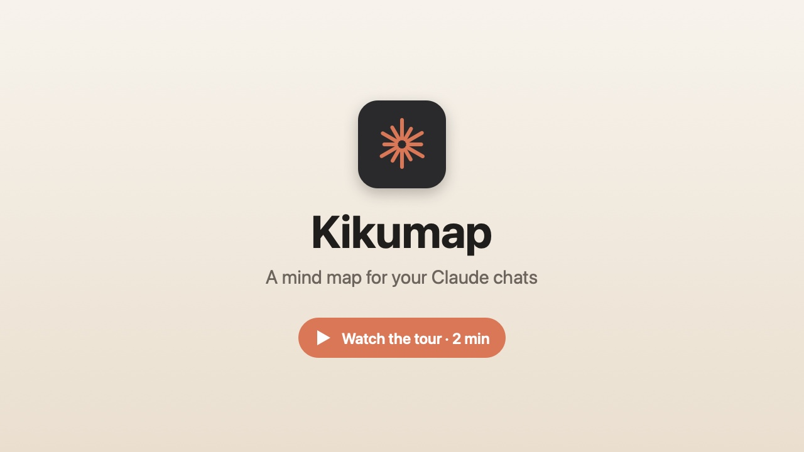
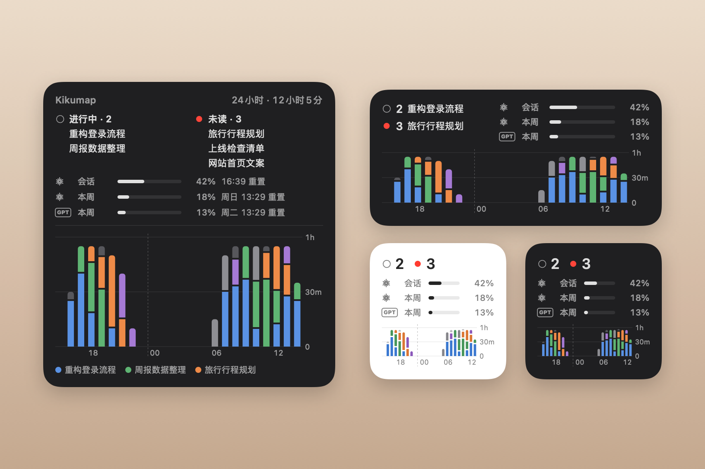

<p align="center"></p>

<h1 align="center">Kikumap</h1>

<p align="center"><a href="README.md">English</a> · <b>简体中文</b></p>

<p align="center">
  <b>给 Claude 和 ChatGPT 对话的思维导图。</b><br>
  在菜单栏或桌面上一眼看到哪个对话还在跑、哪个在等你。<br>
  把它们整理成一张导图，想带走时一键导出。
</p>

<p align="center">
  <a href="https://github.com/tang1693/KIKUmap/releases/latest"></a>
  
  
  <a href="LICENSE"></a>
  <a href="https://github.com/tang1693/KIKUmap/stargazers"></a>
  <a href="https://ko-fi.com/vegligi"></a>
</p>

<h3 align="center"><a href="https://github.com/tang1693/KIKUmap/releases/latest/download/Kikumap.dmg">⬇︎ 下载 macOS 版</a></h3>

<p align="center"><a href="https://ko-fi.com/vegligi"></a></p>

<p align="center">
  <a href="https://tang1693.github.io/KIKUmap/?lang=zh">官网</a> ·
  <a href="#功能">功能</a> ·
  <a href="#安装">安装</a> ·
  <a href="#隐私">隐私</a> ·
  <a href="#常见问题">常见问题</a> ·
  <a href="#支持">支持 ❤️</a>
</p>

<p align="center"></p>

你在 Claude 里置顶了一堆对话，在 ChatGPT 里也置顶了几个 Codex 对话：一个在规划旅行，一个在修测试，还有一个十分钟前就做完了你还没看。**Kikumap** 住在菜单栏里帮你同时盯着两边：哪个在跑、哪个做完了、哪个在等你批准。打开它，置顶对话就是一张由你自己整理的思维导图，用法像 MindNode。桌面小组件也能一眼看到这些，还有 Claude 和 ChatGPT 的用量。

**原生，轻到几乎感觉不到。** 纯 Swift + AppKit：没有 Electron、没有网页套壳、没有后台助手进程、没有任何第三方代码。安装包很小，主要靠系统通知等变化（每半分钟轻量检查一次），窗口一隐藏就完全停止绘制。

<p align="center"><a href="https://tang1693.github.io/KIKUmap/#tour"></a></p>

> [!NOTE]
> **须知。** Claude App 没有公开接口，Kikumap 是通过 macOS「辅助功能」读它的窗口；ChatGPT 的对话来自它的桌面 App 存在你 Mac 上的文件。任一边改版后，部分功能可能要等 Kikumap 更新才能恢复。本项目由个人独立开发，与 Anthropic、OpenAI 都无关。

## 功能

<table>
<tr>
<td width="55%"></td>
<td>

### 随时知道 Claude 和 ChatGPT 在干什么

菜单栏只有一个图标。橙色小菊花在转，就是有置顶的对话在跑；红色数字是做完了还没看的对话，带 **!** 表示有对话在等你批准。

**听声音就知道，不用去查。** 对话做完或在等你时会响提示音，还可以接着念出是哪个对话（“定价方案做完了”）。声音、语速、念的内容都能自己改，也可以换成自己的声音文件。

支持 Claude 桌面 App、Claude Code（终端、VS Code、App 的 Code 模式），以及 ChatGPT 桌面 App。ChatGPT 这边显示在你 Mac 上运行的对话：你在 ChatGPT 里置顶的 **Codex** 对话（置顶的对话和置顶项目里的对话）会和 Claude 的对话放在一起，前面标着 **GPT**，顺序和 ChatGPT 一样；进行中、未读跟 ChatGPT 自己的小圆点一致。VS Code、终端里的 Codex 会话和 Claude Code 会话一样显示：运行中、未读，以及做完后 12 小时内。普通 ChatGPT 聊天存在云端、不在你的 Mac 上，置顶了也不会显示。不用任何设置：Kikumap 读 ChatGPT 存在你 Mac 上的内容。

</td>
</tr>
<tr>
<td>

### 对话变成一张导图

左栏是你在 Claude 里置顶的对话和在 ChatGPT 里置顶的 Codex 对话，**顺序和各自的 App 一样**，还有你的 Claude Code 会话。导图一开始是空的，放什么由你决定。把它们拖到自己的主题下：拖动时节点带着实时连线跟着走，其他节点会让开，空出它要落下的位置。你不动，布局就不会自己变。

**一次拖好几个：** 在导图空白处拖出选框（或 ⌘/⇧ 点击），或在左栏 ⌘/⇧ 点击，然后拖其中任意一个，选中的会按顺序一起过去。按住空格移动鼠标、或双指滑动，就能移动导图。左栏和时间线可以隐藏（⌃⌘S、⌃⌘T），也能拖边缘调宽窄；⌘+ / ⌘- 让整个窗口的字一起变大变小。

真正的对话前面有橙色小标记。鼠标停在上面会出现两个按钮：在 Claude 或 ChatGPT 里打开，或者标回未读（⇧⌘U），在你真正打开之前一直提醒你。

</td>
<td width="55%"></td>
</tr>
<tr>
<td width="55%"></td>
<td>

### 按你的习惯整理

右键任意主题，换分支颜色、选图形：方块、圆圈、三角、菱形、交叉、星星。颜色会顺着分支往下，时间线和菜单里也跟着用。

</td>
</tr>
<tr>
<td>

### 什么都能打标签

比如「进行中」「等别人」「幻灯片」。右键菜单里勾选，或者从左下角的标签栏直接拖到对话上。

点一下标签，带这个标签的都会高亮，其他的淡下去。再点一下取消。

</td>
<td width="55%"></td>
</tr>
<tr>
<td width="55%"></td>
<td>

### 键盘就能搞定

和专业导图软件一样：⇥ 新建子主题，⏎ 同级主题，⌥↑↓ 调整顺序，⌘Z 撤销。还有 ⌫ 删除、⌥. 折叠、⌘F 搜索，⌘↓（或轻按空格）在对应的 App 里打开对话，和访达一样。

</td>
</tr>
<tr>
<td>

### 做过什么，接下来做什么

底部的时间线显示 Claude 和 ChatGPT 什么时候在做哪个对话，用你的分支颜色；同时在跑的对话各占一行。往后拖，就能看到接下来的计划任务（需开启用量），每个都带实时倒计时。点一下就能打开。

</td>
<td width="55%"></td>
</tr>
<tr>
<td width="55%"></td>
<td>

### 全部带走

勾选主题，下面所有对话（置顶的、没置顶的都算）一次导出，每个对话一个文件夹：

- `memory.md`：Claude 在对话里写的交接总结
- `prompts.md` 和 `conversation.md`
- `artifacts/` 和 `attachments/`

导出可以自动保持最新。**导入**会为每个文件夹开一个新的置顶对话（比如换到新的 Claude 账号），把总结和 artifacts 作为附件发进去，接着做就行。

</td>
</tr>
<tr>
<td>

### 放在桌面上 <sup>新</sup>

桌面或通知中心的小组件，小、中、大三种尺寸。上面是进行中和未读的对话；接着是用量：Claude 的（5 小时会话和本周）、ChatGPT 的，或两个都有，每一行都标着是谁的；下面是最近 24 小时的柱状图，每个对话一种颜色。点对话就能打开。

在桌面右键 → **编辑小组件**，搜 Kikumap。需要 macOS 14 或更新。

</td>
<td width="55%"></td>
</tr>
<tr>
<td width="55%"></td>
<td>

### 干了多少活 <sup>新</sup>

Claude 和 ChatGPT 干了多久，按对话分段；每根柱子可以是 1、3、6、12、24 或 48 小时，看最近 7、14、30 或 90 天。鼠标停上去看详情，点一段就打开那个对话。显示 → 统计（⌘Y），或窗口顶上的图表按钮。

</td>
</tr>
</table>

### 还有更多

<table>
<tr>
<td width="50%" valign="top"><br><b>做完的对话会亮</b><br>做完还没看的对话，在导图上变成实心，还带一个红点。</td>
<td width="50%" valign="top"><br><b>搜索</b><br>⌘F 搜主题、对话和标签，⏎ 跳到下一个。</td>
</tr>
<tr>
<td width="50%" valign="top"><br><b>今日回顾</b><br>今天 Claude 和 ChatGPT 做了哪些对话、各用了多久，菜单里就能看。</td>
<td width="50%" valign="top"><br><b>用量</b><br>当前会话和本周用量，和 claude.ai 一样，还有接下来的计划任务。</td>
</tr>
<tr>
<td width="50%" valign="top"><br><b>导出 PDF</b><br>整张导图导出成一页浅色 PDF，打印、分享都行。</td>
<td width="50%" valign="top"><br><b>每日备份</b><br>每天第一次改动之前，自动存一份导图。</td>
</tr>
<tr>
<td width="50%" valign="top"><br><b>浅色和深色</b><br>跟随系统，或者点月亮按钮切换。</td>
<td width="50%" valign="top"><br><b>English · 中文</b><br>所有文字、菜单和标签，中英文都有。</td>
</tr>
</table>

## 能看到什么，看不到什么

Kikumap 读的是各个 App 存在这台 Mac 上的东西。它从不登录你的账号；开了用量后，只用这台 Mac 上 Claude Code 的登录，向 Anthropic 查你的用量和计划任务的时间。

| 能看到 | 看不到 |
|---|---|
| 你在 Claude 里置顶的对话，不管在哪儿开的（手机、网页上置顶的会同步过来），前提是这台 Mac 上开着 Claude 桌面 App | 没置顶的对话；只在浏览器或别的设备上用 Claude、这台 Mac 上没开 Claude App |
| 在这台 Mac 上跑的 Claude Code：终端、VS Code、Cursor、Claude App 的 Code 模式（连接 hook 之后） | 在别的电脑或服务器上跑的 Claude Code：SSH、VS Code 远程、开发容器、云端（它的 hook 在那边运行，不在这台 Mac 上） |
| 你在 ChatGPT 桌面 App 里置顶的 Codex 对话，以及这台 Mac 上 VS Code、终端里的 Codex 会话 | 普通 ChatGPT 聊天（存在云端）、别的电脑或服务器上的 Codex、Codex 云端任务 |
| Claude 的计划任务：名字和运行时间，显示在时间线上（开了用量后） | 计划任务或云端任务运行时具体在做什么 |
| Claude 的用量（通过这台 Mac 上 Claude Code 的登录，需要 Claude 订阅）；ChatGPT 的用量（读它自己的文件） | 按量计费的 API Key 的用量，以及没在这台 Mac 上登录的账号的用量 |

进行中、做完了也都来自这台 Mac：Claude 窗口开在你正在用的桌面上时的侧边栏、Claude Code 的 hook、ChatGPT 的文件。开了「完全磁盘访问」（并且 macOS 里允许 Claude 发通知），Claude 的通知还会告诉它：Claude 要你批准或回答了、Claude App 里的 Cowork 任务做完了；普通对话回复完，Claude 不发通知。（App 里的 Code 会话靠 Claude Code 连接。）首次启动的介绍里有一页图示。

## 安装

**[下载 Kikumap.dmg](https://github.com/tang1693/KIKUmap/releases/latest/download/Kikumap.dmg)**（Apple 芯片和 Intel 通用，macOS 13 及以上），打开后把 **Kikumap** 拖进「应用程序」。

第一次打开时 macOS 会拦住它，因为它没有付费的苹果开发者签名：

1. 在弹出的提示里点 **完成**（不要点「移到废纸篓」），然后打开 **系统设置 → 隐私与安全性**。
2. 往下滑，在 Kikumap 旁边点 **仍要打开**。（macOS 13–14 也可以右键应用 → 打开。）
3. 接下来的简短引导只要你开一个权限：「辅助功能」，让 Kikumap 能看 Claude App 的对话列表。其他都是可选的。最后一页可以选登录 Mac 时自动打开 Kikumap（随时可以在 设置 → 通用 里改）。
4. **把要盯的对话置顶。** Kikumap 盯的是置顶的对话（以及 Claude Code、Codex 会话）：在 Claude 里置顶对话，或在 ChatGPT 里置顶 Codex 对话，它就会出现在菜单、左栏和小组件里。

保持 Claude App 的侧边栏展开、停在 Chat、Pinned 区展开。ChatGPT 不用设置：Kikumap 读它的桌面 App 存在你 Mac 上的内容。以后要删掉 Kikumap：先关掉 设置 → 通用 → *登录时自动启动*，连过 Claude Code 的话再在 设置 → 授权 里点 *断开 Claude Code*，然后把 App 拖进废纸篓。

<details>
<summary><b>从源码编译</b></summary>

需要 Xcode 命令行工具（macOS 会提示安装）。

```bash
git clone https://github.com/tang1693/KIKUmap.git
cd KIKUmap
open Install.command        # 或者在 Finder 里双击它
```

`Install.command` 用 `swiftc` 编译（需要 Swift 5.10 或更新），装到 `~/Applications`，并问你要不要开机启动。它会在登录钥匙串里建一个本地签名证书（只建一次），这样你开过的权限在以后重新编译后依然有效。`scripts/build-release.sh` 用来打包通用版 DMG。
</details>

## 隐私

所有数据都在本机 `~/Library/Application Support/ClaudeConsole/`。唯一的网络请求是向 `api.anthropic.com` 查询用量，而且只在你开启用量功能之后（默认关闭）。ChatGPT 的用量从它自己的文件里读，不联网。

不会突然弹窗：每个系统授权弹窗，都会先告诉你要做什么，你点了同意才出现。

| 显示什么 | 从哪里来 | 权限 |
|---|---|---|
| 要你批准或回答、Cowork 任务做完了，Claude 窗口关着也知道（可选） | 通知中心里 Claude 的通知（只读；要在 macOS 里允许 Claude 发通知） | 完全磁盘访问 |
| 进行中、未读、置顶对话 | 通过「辅助功能」读 Claude 的侧边栏 | 辅助功能 |
| Claude Code 会话 | 点「连接」时写进 `~/.claude/settings.json` 的 hooks（原文件会备份） | 不需要 |
| ChatGPT 的 Codex 对话 | ChatGPT 桌面 App 存在 `~/.codex` 里的内容：对话列表和置顶、哪些未读、最近一次回答带的套餐用量（只读，不改任何东西）；可在 设置 → 授权 里关掉 | 不需要 |
| 桌面小组件 | Kikumap 专门写给它的一个文件（`widget.json`）；小组件在沙盒里，只能读这一个文件 | 不需要 |
| 用量、计划任务（可选，默认关闭；Claude 付费套餐） | Anthropic 用量接口，用 Claude Code 已存在钥匙串里的登录：只读、不保存 | 钥匙串，你开启后才问 |

**日志：** 同一目录下的 `logs/` 只记出问题时用得上的简短信息，每个日志约 2 MB 封顶。通知日志只记 Claude 的通知什么时候来、属于哪个对话，从不记内容；1.0 之前记过内容的旧日志会在第一次启动时删掉。

**关于导出：** 交接总结是 Claude 在每个对话里写的，所以每个对话会多一轮问答，运行时 Claude 窗口会自己切换对话。提示词、完整对话和 artifacts 来自 Claude 官方的数据导出（Claude → 设置 → 隐私 → 导出数据），在导出窗口里选这个 zip 就行（开了完全磁盘访问的话，放在「下载」里会自动找到）。导入同样会操作 Claude 窗口；图片等二进制文件无法带过去。

## 导图快捷键

| | |
|---|---|
| ⇥ / ⌥⇥ | 新建子主题 / 新建父主题 |
| ⏎ / ⌥⏎ / ⇧⏎ | 在下方 / 上方新建同级主题 / 新建一级主题 |
| ⌘⏎、双击 | 改名（对话名只在本机生效） |
| ⌫ | 删除；置顶的对话回到左栏 |
| ⌥. | 折叠 / 展开 |
| ⌥↑ ⌥↓ | 在同级之间移动 |
| ⌘↓ / ⌘↑ | 在它的 App 里打开对话 / 回到所在的主题（和访达一样） |
| 在空白处拖动、⇧/⌘ 点击 | 多选；拖其中任意一个，全部一起移动 |
| 按住空格、双指滑动 | 移动导图（轻按空格是打开对话） |
| ⌃⌘S / ⌃⌘T | 显示或隐藏左栏 / 时间线 |
| ⌘Y | 统计 |
| ⌘R、⟳ | 刷新：马上重新读 Claude、ChatGPT 和用量 |
| ⌘A、⌫ | 全选；删除选中的 |
| ⌘Z / ⇧⌘Z | 撤销 / 重做 |
| ⌘F | 搜索 |
| ⌘E / ⇧⌘E | 导出导图 PDF / 导出对话 |
| ⌘↓、轻按空格、鼠标停在对话上 → ↗ | 在 Claude 或 ChatGPT 里打开 |
| ⇧⌘U、鼠标停在对话上 → ✉ | 标为未读 / 已读 |
| ⌘+ / ⌘- | 整个窗口放大 / 缩小（80–160%） |
| 双指捏合、⌘0 | 缩放导图、适应窗口 |
| ⌃⌥C（可改） | 在任何地方呼出 / 收起导图 |

## 常见问题

<details>
<summary><b>用 ⌘W 关了 Claude 的窗口怎么办？</b></summary>

Claude 的 ⌘W 只是把窗口藏起来，App 还在运行；但 Kikumap 是从 Claude 的侧边栏读对话的，所以要等窗口回来（点程序坞里的 Claude）才看得到。窗口在别的桌面上（包括全屏）也一样。被别的窗口挡住或最小化时，照样能读。这期间，在跑的对话显示「在跑？」，看不到的这段时长是估算的，标 ≈（按你一次运行的常见时长算，不超过它被看到做完的时候）。开了「完全磁盘访问」（可选）的话，Claude 要你批准或回答、Cowork 任务做完时，通知照样能收到（做完的时长算到通知那一刻）。普通对话回复完，Claude 不发通知，要等窗口回来才知道。终端或 VS Code 里的 Claude Code、ChatGPT 的 Codex 完全不受影响。

</details>

<details>
<summary><b>这是 Anthropic 或 OpenAI 官方做的吗？</b></summary>

不是。Kikumap 是个人独立开发的开源项目。Claude 是 Anthropic 的商标，ChatGPT 是 OpenAI 的商标。
</details>

<details>
<summary><b>为什么需要「辅助功能」？</b></summary>

Claude App 没有“哪些对话在跑”的接口，所以 Kikumap 像你一样去看它的对话列表，macOS 把这叫「辅助功能」。这是 Kikumap 唯一需要的权限。「完全磁盘访问」是可选的：开了能读 Claude 的通知，Claude 要你批准或回答时、Cowork 任务做完时，窗口关着也知道。Kikumap 只用它们读取；只有你让它在 Claude 里操作时（打开对话、导出和导入，会在 Claude 窗口里输入）才会点按。数据不会离开你的 Mac。
</details>

<details>
<summary><b>为什么要点「仍要打开」？</b></summary>

苹果的开发者签名和公证每年要 99 美元。Kikumap 是免费的，所以没有公证。不放心下载的版本的话，可以从源码编译：纯 Swift，没有任何依赖。
</details>

<details>
<summary><b>有东西没显示出来</b></summary>

- **顶栏的「▸ 待办」**：列出还没做的事（开权限、打开 Claude、为用量登录……），每一件没做会影响什么，以及一个直接去做的按钮。用不着的可以忽略，之后不会再提醒，想要时再找回来。左栏空着时，也会写出正在读什么、上次什么时候读的、下次什么时候读。
- **有东西不正常**：设置 → 授权 → *诊断报告*，会生成 `kikumap-check.txt`：Kikumap 在这台 Mac 上能看到什么、怎么读 Claude 的侧边栏。里面没有对话标题、内容和密码，可以直接附到 issue 里。
- **没有任何对话显示“进行中”**：Kikumap 只盯置顶的对话，先在 Claude 里把它置顶。再保持 Claude 的侧边栏展开（停在 Chat、Pinned 区展开）；还不行就生成诊断报告。
- **重启后 Kikumap 没有自己打开**：在「应用程序」里的那份 Kikumap 中打开 设置 → 通用 → *登录时自动启动*（顶栏「▸ 待办」也会提示）。开了还是不行的话，看看 系统设置 → 通用 → 登录项 里是否允许了 Kikumap。
- **系统设置里开了权限，这里却显示没开**：先退出并重新打开 Kikumap（「完全磁盘访问」要重新打开才生效）；还不行就在系统设置的列表里把 Kikumap 删掉（−）再加回来。从 0.9.1 起，每个版本都用同一张证书签名，更新后权限会保留。
- **Claude Code 会话没显示**：设置 → 授权 → Claude Code → *连接*，然后开一个新会话。如果显示 hook 被关掉了，是你（或你组织）的 Claude Code 设置关掉了 hook（`disableAllHooks`，或托管设置）。用 `CLAUDE_CONFIG_DIR` 启动的 Claude Code 用的是另一个设置文件，Kikumap 连不到它。
- **ChatGPT 对话没显示**：Kikumap 读的是新版 ChatGPT 桌面 App（Codex 内核），而且只读它存在你 Mac 上的 Codex 对话；普通 ChatGPT 聊天存在云端，显示不了。看一下 设置 → 授权 → ChatGPT。和 Claude 的对话一样，Codex 对话在 ChatGPT 里置顶（或放进置顶项目）后才会显示。
- **小组件库里找不到 Kikumap**：需要 macOS 14 或更新，并且 Kikumap 在「应用程序」里。先打开一次 Kikumap，再在桌面右键 → *编辑小组件*，搜 Kikumap。还是没有的话，在终端运行 `pluginkit -m -v -i ninja.tang.claudeconsole.widget`，把输出发到 issue 里。
- **没有用量**：用量默认关闭，先在 设置 → 授权 → 用量 → *连接* 打开。它借用 Claude Code 的登录读取，所以这台 Mac 上要有 Claude Code，并用 Claude 付费套餐（Pro、Max、Team 或 Enterprise）登录：装好 Claude Code，在终端运行 `claude`，输入 `/login`，选你的 Claude 账号。免费套餐和 API key 没有用量可看。标着「…时的数据」的是上次读到的数，Claude Code 的登录恢复后会自动更新。
</details>

<details>
<summary><b>名字是什么意思？</b></summary>

*Kiku*（菊）是日语里的菊花，就是菜单栏里那朵 Claude 干活时会转的橙色小菊花；Kikumap 就是从它长出来的导图。
</details>

## 参与贡献

欢迎提 issue 和 pull request，尤其是 Claude 或 ChatGPT 更新后有东西坏掉的时候：[提个 issue](https://github.com/tang1693/KIKUmap/issues)，说说你看到了什么。

代码是纯 Swift + AppKit，没有 Xcode 工程，也没有依赖。各文件的作用见[英文 README](README.md#contributing)。

<a href="https://star-history.com/#tang1693/KIKUmap&Date">
  
</a>

## 支持

Kikumap 是免费的，以后也会一直免费。如果它每天帮你省下一点翻找标签页的时间，请我喝杯咖啡，它就能一直做下去 ❤️

<p><a href="https://ko-fi.com/vegligi"></a></p>

在 GitHub 点个 ⭐，或者反馈一个问题，也一样有帮助。

## 协议

[MIT](LICENSE)。Claude 是 Anthropic 的商标，ChatGPT 是 OpenAI 的商标；本项目独立开发，未获两家认可。
