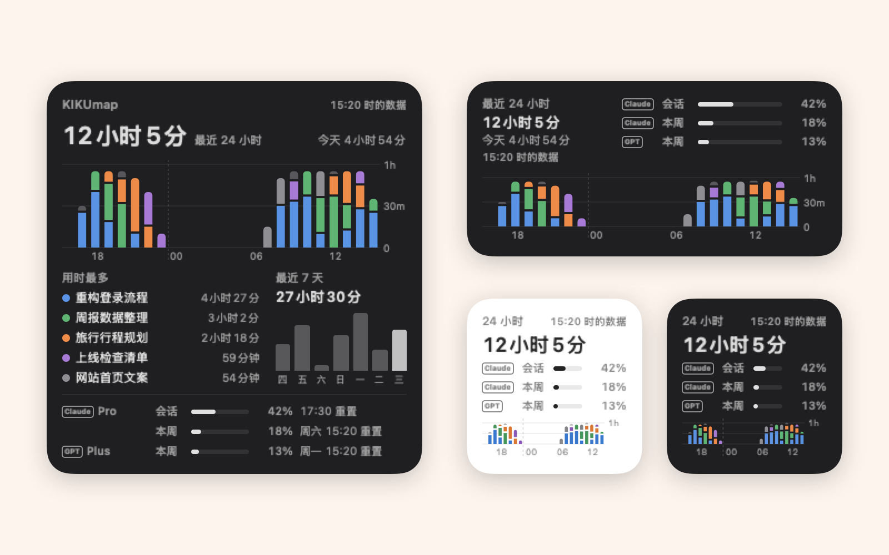

<picture>
  <source media="(prefers-color-scheme: dark)" srcset="docs/banner-zh-dark.png">
  
</picture>

<p align="center"><a href="README.md">English</a> · <a href="README.zh-CN.md">简体中文</a> · <b>繁體中文</b> · <a href="README.ja.md">日本語</a> · <a href="README.ko.md">한국어</a> · <a href="README.es.md">Español</a> · <a href="README.pt-BR.md">Português</a> · <a href="README.de.md">Deutsch</a> · <a href="README.fr.md">Français</a></p>

<p align="center">住在 Mac 選單列裡的心智圖，管理 Claude 和 ChatGPT 的對話。<br>哪個還在跑、哪個做完了、哪個在等你，一眼就知道。</p>

<p align="center"><a href="https://github.com/tang1693/KIKUmap/releases/latest/download/Kikumap.dmg"></a>&nbsp;&nbsp;<a href="https://tang1693.github.io/KIKUmap/?lang=zh-Hant"></a></p>

<p align="center"><a href="https://www.producthunt.com/products/kikumap?embed=true&amp;utm_source=badge-featured&amp;utm_medium=badge&amp;utm_campaign=badge-kikumap" target="_blank" rel="noopener noreferrer"></a></p>

<p align="center">
  <a href="https://github.com/tang1693/KIKUmap/releases/latest"></a>
  
  
  
  <a href="LICENSE"></a>
  <a href="https://github.com/tang1693/KIKUmap/stargazers"></a>
  <a href="https://ko-fi.com/vegligi"></a>
</p>

<p align="center">
  <a href="https://tang1693.github.io/KIKUmap/?lang=zh">官網</a> ·
  <a href="#功能">功能</a> ·
  <a href="#安裝">安裝</a> ·
  <a href="#隱私">隱私</a> ·
  <a href="#常見問題">常見問題</a> ·
  <a href="#支持">支持 ❤️</a>
</p>

<p align="center"></p>

<p align="center"><a href="https://tang1693.github.io/KIKUmap/?lang=zh#tour"></a></p>

## 功能

<table>
<tr>
<td width="55%"></td>
<td>

### 1. 在選單列看狀態
圓環裡是執行中的對話數；紅色標記是做完但還沒看的對話數，有對話在等你（要你確認或回答，或是出錯停下了）時帶 **!**。可以開提示音，或用語音說出是哪個對話做完了。

</td>
</tr>
<tr>
<td>

### 2. 對話變成心智圖
Claude 和 ChatGPT App 裡釘選的對話、Claude Code 工作階段，都會列在左欄。把它們拖到自己的主題下。每個對話都標著 **Claude** 或 **GPT**。

</td>
<td width="55%"></td>
</tr>
<tr>
<td width="55%"></td>
<td>

### 3. 顏色、形狀、標籤
幫主題設定顏色和形狀。幫對話加標籤，點一下標籤就醒目標示所有帶它的對話。拖動標籤區的上緣可以調整高度，也可以整個收起（⌃⌘G）。視窗太矮又放大時放不下，標籤區會先讓開：把視窗拉高，或按 ⌘- 縮小。

設定 → 配色裡有 8 套整個視窗的配色（經典黑白、KIKU 花、包浩斯黑、復古、深海、霓虹、日落、糖果），也可以每個顏色自己挑。

</td>
</tr>
<tr>
<td>

### 4. 鍵盤就能搞定
⇥ 子主題 · ⏎ 同級 · ⌥↑↓ 移動 · ⌘Z 還原 · ⌘F 搜尋 · 空白鍵打開對話。

</td>
<td width="55%"></td>
</tr>
<tr>
<td width="55%"></td>
<td>

### 5. 時間軸
每個對話什麼時候在跑，接下來有哪些排程工作，附倒數計時。

</td>
</tr>
<tr>
<td>

### 6. 匯出和匯入
每個 Claude 對話匯出成檔案：摘要、提示詞、完整對話和產出物。也能匯入到另一個 Claude 帳號。

</td>
<td width="55%"></td>
</tr>
<tr>
<td width="55%"></td>
<td>

### 7. 桌面小工具
最近 24 小時和最近 7 天的工作時數，以及 Claude、ChatGPT 的用量和方案名稱。三種尺寸，需要 macOS 14 以上。

</td>
</tr>
<tr>
<td>

### 8. 統計
每個對話和工作階段的用時，可以看 7、14、30 或 90 天。⌘Y。

</td>
<td width="55%"></td>
</tr>
</table>

<table>
<tr>
<td width="50%" valign="top"><br><b>做完的對話</b>會在心智圖上亮起。</td>
<td width="50%" valign="top"><br><b>搜尋</b>主題、對話和標籤。</td>
</tr>
<tr>
<td width="50%" valign="top"><br><b>今天</b>哪些對話和工作階段做了事、做了多久。</td>
<td width="50%" valign="top"><br>目前工作階段和本週的<b>用量</b>。</td>
</tr>
<tr>
<td width="50%" valign="top"><br>整張心智圖匯出 <b>PDF</b>。</td>
<td width="50%" valign="top"><br>心智圖<b>每日備份</b>。</td>
</tr>
<tr>
<td width="50%" valign="top"><br><b>淺色、深色</b>都有。</td>
<td width="50%" valign="top"><br><b>9 種語言：</b> English · 简体中文 · 繁體中文 · 日本語 · 한국어 · Español · Português · Deutsch · Français</td>
</tr>
</table>

**支援：** Claude 桌面 App · Claude Code（終端機、VS Code、Cursor、App 裡的 Code 模式）· ChatGPT 桌面 App · VS Code 或終端機裡的 Codex。

**原生、輕量：** 純 Swift + AppKit。沒有 Electron，沒有網頁套殼，沒有第三方程式碼（線條圖示來自 [Lucide](https://lucide.dev)，ISC 授權）。

## 安裝

1. [下載 Kikumap.dmg](https://github.com/tang1693/KIKUmap/releases/latest/download/Kikumap.dmg)（macOS 13 以上，Apple 晶片和 Intel 都支援），把 KIKUmap 拖到「應用程式」。
2. 第一次打開時，macOS 會提示無法檢查這個 App（它沒有經過公證）：點「完成」，再到 **系統設定 → 隱私權與安全性**，點「仍要打開」。
3. 引導頁要求**輔助使用**權限時，允許它。其他權限都是選用的。
4. 在 Claude 或 ChatGPT 裡釘選對話，KIKUmap 就會追蹤它們。

<details>
<summary>從原始碼建置</summary>

需要 Xcode 命令列工具。

```bash
git clone https://github.com/tang1693/KIKUmap.git
cd KIKUmap
open Install.command
```

`Install.command` 用 `swiftc` 編譯，安裝到 `~/Applications`，並用本機憑證簽署，所以重新編譯後權限還在。`scripts/build-release.sh` 產生磁碟映像檔。
</details>

## 隱私

- 所有資料都留在本機，放在 `~/Library/Application Support/ClaudeConsole/`。
- 必要的權限只有一個：**輔助使用**，用來讀取 Claude 和 ChatGPT 視窗裡的對話列表。每個權限都會先說明用途，再由 macOS 跳出視窗要求。
- 不連網。唯一的例外是選用的用量查詢（預設關閉）：開啟後，會借用 Claude Code 和 Codex 已經存在本機的登入資訊，向 Anthropic 和 OpenAI 查詢用量，登入資訊不會被儲存。這兩家都沒有表示允許 App 這樣查詢，以後可能會被限制。
- 匯出（寫摘要時）和匯入會借用剪貼簿貼上。KIKUmap 自己貼上的內容會加上標記，讓剪貼簿紀錄類 App 略過，也不會同步到你的其他裝置；每份摘要要經過 Claude 自己的複製按鈕，剪貼簿紀錄類 App 可能會存下。每一步之後都會放回你原本的剪貼簿內容。

<details>
<summary>每個資料來源和權限的用途</summary>

| 顯示的內容 | 來源 | 權限 |
|---|---|---|
| Claude 釘選對話：執行中、未讀 | Claude App 的側邊欄 | 輔助使用 |
| 在等你確認（核准或回答）、Cowork 任務做完，Claude 視窗關著時也能收到（選用） | 通知中心裡 Claude 的通知 | 完整磁碟取用權限 |
| Claude Code 工作階段 | `~/.claude/settings.json` 裡的 Claude Code hook（修改前會先備份原檔案） | 不需要 |
| ChatGPT 的對話 | ChatGPT App 存在 `~/.codex` 裡的檔案（唯讀） | 不需要 |
| ChatGPT 一般對話（非 Codex）：執行中、做完、未讀 | ChatGPT 視窗的左欄，視窗露出一部分時才讀取 | 輔助使用 |
| 做完的工作階段你正看著時算已讀 | 它所在的編輯器或終端機在最前面時的視窗標題 | 輔助使用 |
| 桌面小工具 | KIKUmap 專門為它寫的一個檔案（`widget.json`） | 不需要 |
| Claude 用量和排程工作（選用） | Anthropic 的用量 API，借用 Claude Code 的登入資訊 | 鑰匙圈 |
| ChatGPT 用量（選用，實驗性） | OpenAI 的用量介面，借用 Codex 的登入資訊 | 不需要 |

ChatGPT：Codex 對話支援得最好（讀取 App 的檔案，視窗關著也準）。一般對話支援有限：只能從 ChatGPT 的視窗裡讀取，視窗要露出一部分。

不會顯示：沒釘選的對話，以及在別台電腦、伺服器或雲端執行的任何東西。
</details>

<details>
<summary>所有快捷鍵</summary>

| | |
|---|---|
| ⇥ / ⌥⇥ | 新增子主題 / 父主題 |
| ⏎ / ⌥⏎ / ⇧⏎ | 在下方 / 上方新增同級 / 新增主主題 |
| ⌘⏎、按兩下 | 重新命名 |
| ⌫ / ⌥⌫ | 刪除（釘選的對話仍在左欄）/ 只刪主題、保留底下的項目（多選時也一樣） |
| ⌥. | 收合 / 展開 |
| ↑ ↓ ← → | 選取那個方向最近的項目 |
| ⌥↑ ⌥↓ / ⌥← ⌥→ | 上下移動 / 移動一層 |
| ⌘↓、輕按空白鍵 | 在對應的 App 裡打開對話 |
| ⌘↑ | 回到所在的主題 |
| 在空白處拖曳框選、⇧/⌘ 點按 | 多選 |
| 按住空白鍵、雙指滑動 | 移動心智圖 |
| ⌃⌘S / ⌃⌘G / ⌃⌘T | 左欄 / 標籤 / 時間軸 |
| 左欄裡 ↑ ↓ | 選上一列 / 下一列（心智圖上同時選取這個對話） |
| 左欄裡 ⏎、空白鍵 | 在它的 App 裡打開對話 |
| ⌘Y | 統計 |
| ⌘R | 重新整理 |
| ⌘Z / ⇧⌘Z | 還原 / 重做 |
| ⌘F | 搜尋 |
| ⌘E / ⇧⌘E | 心智圖匯出 PDF / 匯出對話 |
| ⇧⌘U | 標為未讀 / 已讀 |
| ⌘+ / ⌘- / 雙指捏合 / ⌘0 | 放大 / 縮小 / 縮放 / 符合視窗大小 |
| ⌃⌥C（可更改，但不能用 KIKUmap 自己的 ⌃⌘S / ⌃⌘G / ⌃⌘T / ⌥⌘H） | 隨時顯示或隱藏心智圖 |
</details>

## 常見問題

<details>
<summary><b>這是 Anthropic 或 OpenAI 做的嗎？</b></summary>

不是。KIKUmap 是獨立的開源專案。Claude App 沒有公開的介面，KIKUmap 透過「輔助使用」讀取它的視窗；Claude 或 ChatGPT 改版後，部分功能可能要等 KIKUmap 更新才能恢復。
</details>

<details>
<summary><b>為什麼要點「仍要打開」？</b></summary>

公證需要付費的 Apple 開發者帳號，而 KIKUmap 是免費的。也可以從原始碼自己編譯：純 Swift，沒有相依套件。
</details>

<details>
<summary><b>Claude 的視窗關了會怎樣？</b></summary>

⌘W 只是把視窗藏起來。KIKUmap 從視窗裡讀取 Claude 的對話，所以要等視窗回到目前的桌面才看得到；在那之前，原本在跑的對話會顯示「在跑？」；視窗回來後發現已經做完的，會顯示「14:00 後做完」（最後一次看到它在跑的時間），因為不知道它確切什麼時候做完。Claude Code 和 Codex 對話不受影響。ChatGPT 的一般對話也是從 ChatGPT 的視窗裡讀取的，視窗露出一部分才看得到。
</details>

<details>
<summary><b>工作階段做完時我正看著它，為什麼還是未讀？</b></summary>

只有在最前面的視窗只可能屬於這個工作階段時，KIKUmap 才會自動把做完的工作階段標為已讀：Claude Code 是 VS Code 或 Cursor 裡打開它資料夾的視窗，或是標題裡同時有它的資料夾和 `claude` 的終端機視窗；Codex 是 VS Code 裡打開它資料夾的視窗。如果別的視窗或分頁也可能在顯示它，它會保持未讀，例如編輯器裡另有視窗開著它的資料夾或上層資料夾。終端機裡的 Codex 工作階段也會保持未讀（KIKUmap 不知道它在哪個終端機裡跑）。在 KIKUmap 裡打開它，或選取它後按 ⇧⌘U，就會標為已讀。
</details>

<details>
<summary><b>有東西沒顯示</b></summary>

- 頂欄的 **▸ 待辦** 會列出缺了什麼，每一項都有按鈕可以直接處理。
- Claude 對話：先釘選，並讓 Claude 的側邊欄開著，停在 Chat，Pinned 展開。
- Claude Code：設定 → 授權 → Claude Code → **連接**，然後開一個新的工作階段。
- 小工具：需要 macOS 14 以上，KIKUmap 要裝在「應用程式」裡。在桌面按右鍵 → **編輯小工具**。
- 還是不行：設定 → 授權 → **診斷報告**（裡面沒有對話標題和內容），然後[提交 issue](https://github.com/tang1693/KIKUmap/issues)。
</details>

<details>
<summary><b>名字的由來？</b></summary>

*Kiku*（菊）是日語裡的菊花，就是選單列裡那朵小花。
</details>

## 參與貢獻

歡迎提 issue 和 pull request，尤其是 Claude 或 ChatGPT 更新後出問題的時候。請看[貢獻指南](.github/CONTRIBUTING.md)和[行為準則](.github/CODE_OF_CONDUCT.md)；安全問題請依照[安全政策](.github/SECURITY.md)私下回報。

## 支持

KIKUmap 免費。覺得有用的話，請我喝杯咖啡 ❤️

<p><a href="https://ko-fi.com/vegligi"></a></p>

## 授權

[MIT](LICENSE)。Claude 是 Anthropic 的商標，ChatGPT 是 OpenAI 的商標；本專案獨立開發，未獲任何一方背書。
