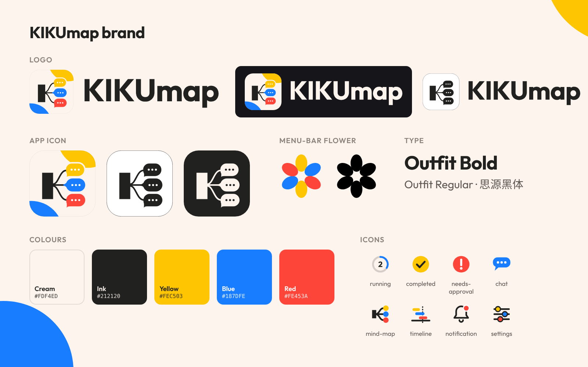

# KIKUmap 品牌规范 / Brand guide

## 名字 Name
- 写作 **KIKUmap**：KIKU 大写，map 小写。界面、README、官网、视频里都这样写。
- 只有文件名保持原样：`Kikumap.dmg`（下载链接要用）。

## Logo
| 文件 | 用途 |
|---|---|
| `logo.svg` | 图标 + 字标，浅色背景 |
| `logo-on-dark.svg` | 深色背景 |
| `logo-mono.svg` | 单色（打印、盖章、单色场合） |
| `wordmark.svg` / `wordmark-light.svg` | 只有字标（已转曲，不依赖字体） |

- 四周留白至少是图标高度的 1/4。
- 不要拉伸、旋转、加描边或阴影，不要放在花哨的背景上。

## App 图标 App icon
- K 分出三根线，连到黄、蓝、红三个对话气泡；米白底，右上黄、左下蓝两块圆弧。
- `app-icon.svg` / `app-icon-1024.png`：macOS 图标网格（1024 画布，824 圆角方块，带阴影）。
- `app-icon-flat.svg`：只有方块，没有阴影，适合放进页面和版面。
- `app-icon-mono.svg` / `app-icon-mono-dark.svg`：单色版。
- 小尺寸：64 px 去掉气泡里的白点，32 px 及以下再去掉两块圆弧（App 里的 `Logo.appIcon` 已经这样画）。

## 菜单栏小花 Flower
- 六片椭圆花瓣，从顶部顺时针黄、蓝、红、黄、蓝、红，中心留空。
- `flower.svg`：三色；`flower-mono.svg`：单色（`currentColor`，可当模板图标）。
- 只用在小地方：菜单栏、窗口左上角、对话前的小标记。正式场合用 App 图标。

## 颜色 Colours
| 名称 | 色值 | 用途 |
|---|---|---|
| Cream 米白 | `#FDF4ED` | 背景、图标底色 |
| Ink 墨 | `#212120` | 文字、K、线条 |
| Yellow 黄 | `#FEC503` | 强调色 1 |
| Blue 蓝 | `#187DFE` | 强调色 2，按钮（下载） |
| Red 红 | `#FE453A` | 强调色 3 |

- 不用 Claude 的品牌橙 `#D97757`。
- 三种强调色按黄、蓝、红的顺序出现（图标气泡、小花、三色条都是这个顺序）。

## 字体 Type
- 品牌字体：**Outfit**（Bold 700 用于字标和标题，Regular 400 用于标语）。
- 中文：思源黑体（Noto Sans SC）。
- App 界面用系统字体。
- 全大写的英文缩写字间距要紧（约 0.05em），不要拉开。

## 功能图标 Icons
`icons/`：running、completed、needs-approval、chat、mind-map、timeline、notification、settings。
48 × 48，墨色线条加一块品牌色，风格和图标一致。

## 其他素材 Other assets
- 首页横幅：`../banner-{en,zh}-{light,dark}.png`（README 顶部，深浅色自动切换）
- 下载按钮：`../download-{en,zh}.svg`
- 社交预览：`../social-preview.png`（1280 × 640，在 GitHub 仓库 Settings → Social preview 上传）
- 产品截图：`../screenshots/`（1600 × 1000）
- 演示 GIF 和介绍视频：`../demo/`（GIF 统一 1600 × 1000；视频 1920 × 1080，中英文各一）
- 发版图：`release-1.0.7.png`（1200 × 630）
- 网站图标：`../favicon.ico`、`../favicon-32.png`、`../apple-touch-icon.png`
